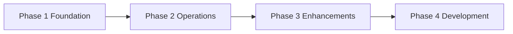

# 06 – Project Phases

> Rule: all custom development (CUS) and integrations are in the **last phase**.

## Phase 1 – Foundation
- **Scope (REQs):**
- **Why first:**
- **Prerequisites:**
- **Deliverables:**
- **Acceptance criteria (review scenarios):**
- **Effort (indicative):**
- **Risks & mitigation:**
- **Client key users needed:**
- **Exit gate:** client sign-off

## Phase 2 – Operations
(same structure)

## Phase 3 – Enhancements (Nice to Have, Studio)
(same structure)

## Phase 4 – Development & Integrations
(same structure; link each item to 09_customization_specs.md)

## Interim workarounds for Must Have CUS items
| REQ | Workaround until Phase 4 | Accepted by (DEC) |
|---|---|---|
